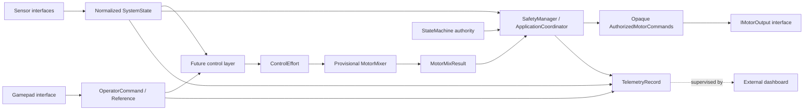

# RAIL-F03A — Firmware Architecture Skeleton

## Purpose and scope

The ESP32 DevKit firmware provides the local boundary for sensor acquisition, normalized state, operator input, safety, operating state, future control, actuator requests, and telemetry. This skeleton establishes data contracts and testable logic only. Hardware drivers, control algorithms, physical ESC output, and telemetry transport are not implemented.

The EX1103 motors and existing propellers remain provisional. Their prototype observation does not validate the estimated final moving mass. Propulsion selection and characterization remain outside this firmware task.

## Module responsibilities

| Module | Responsibility |
|---|---|
| `core` | Shared SI-unit data types, operating/control modes, fault codes, and explicit state transitions. |
| `sensors` | Hardware-independent IMU, height, and limit-switch contracts. Implementations populate normalized values and health/validity. |
| `input` | Gamepad contract that produces a library-independent `OperatorCommand`. |
| `control` | Future controller boundary and provisional `MotorMixer`; no PID behavior is present. |
| `actuators` | Normalized `MotorCommands` output contract; ESC protocol remains TBD. |
| `safety` | Applies authoritative operating-state inhibition, explicitly configured health requirements, emergency-stop authority, finite-command validation, and travel-limit direction checks. |
| `core/ApplicationCoordinator` | Owns the authoritative state machine, propagates safety faults, and publishes telemetry using the resulting state and fault. |
| `telemetry` | Builds an in-memory record from state, references, authorized actuator requests, and fault state. Serialization and transport are absent. |
| `config` | Compile-time software constants. No unverified pins, sensor settings, gains, or electrical values are introduced. |

## Dependency direction

Hardware-specific implementations will depend on the abstract interfaces and normalized core types. Core data models do not depend on sensor or gamepad libraries. Control consumes normalized state and references. Safety is applied after mixer allocation and before any future actuator implementation. Telemetry observes the resulting state and safe actuator request.

The dashboard remains supervisory. It does not participate in the real-time safety or actuator path.

## Normalized data contracts

- `SystemState` uses SI units and contains no device-library types. Numeric measurements have validity flags; default construction means unavailable data, not a zero measurement.
- `SystemMode` represents the operating lifecycle: `BOOT`, `SELF_TEST`, `DISARMED`, `ARMED`, `RUNNING`, `FAULT`, and `EMERGENCY_STOP`.
- `ControlMode` separately reserves `NONE`, `MANUAL`, `ASSISTED`, and `AUTOMATIC`; inactive system states report `NONE`, and no automatic behavior is implemented.
- `OperatorCommand` carries arm/disarm/run/emergency requests, provisional normalized axes, references, and requested control mode without binding to a controller library.
- `ControlEffort` represents controller intent before motor allocation. Its upward sign convention is provisional.
- `MotorCommands` uses a normalized range from `0.0` (minimum/stopped request) through `1.0` (maximum request). This does not establish physical ESC safe behavior.
- `MotorMixResult` is created only by `MotorMixer`. It rejects non-finite base/effort values and overflowed outputs, returning an invalid-command fault and zero normalized request.
- `AuthorizedMotorCommands` has no public constructor from `MotorCommands`. Only `SafetyManager` can create it. It is move-only, tied to the exact state-machine transition generation and safety evaluation, and consumed once. `IMotorOutput::write` rechecks that authority before delegating normalized values to a future driver.
- `SafetyRequirements` is unconfigured by default. A caller must explicitly create a configured policy; a running system with an unconfigured policy receives `SAFETY_POLICY_UNCONFIGURED` and enters `FAULT` through the coordinator. Selected health dependencies remain a project/hardware decision.
- `TelemetryRecord` follows the RAIL-F01 logical baseline and adds validity flags so unavailable values are distinguishable from numeric zero or inactive switch readings.

## State-machine ownership and authority

`ApplicationCoordinator` owns the firmware's non-copyable `StateMachine`; callers cannot construct a second state-machine object to substitute for the coordinator's authority. The coordinator passes that state machine to `SafetyManager`, which reads its current mode directly rather than accepting a caller-supplied `SystemMode`. `StateMachine` starts in `BOOT` and exposes only named transition requests. `begin_self_test` is boot-only; fault and emergency recovery can only use their guarded reset functions. No transitions occur implicitly in the loop. `ARMED` does not grant motor authority; only `RUNNING` does. Fault reset and emergency reset require explicit conditions and both return to `SELF_TEST` before further operation. Emergency stop is latched and has priority over ordinary state transitions.

`SafetyManager` is hardware-independent and locally evaluated. It inhibits output in every state except `RUNNING`, on requested emergency stop, on an unconfigured policy, on injected required-sensor or required-gamepad loss/staleness, on non-finite command data, and on an effort directed farther into an active limit. Since the final thrust mapping is unknown, a blocked direction conservatively inhibits both normalized motor requests; a request away from the active limit can pass when the state and other interlocks allow it. This direction check is provisional and does not validate physical movement. A normalized zero request does not prove an ESC has stopped. Physical emergency power interruption remains a separate hardware design responsibility.

IMU, ToF, limit-switch, and operator-input requirements are selected explicitly through `SafetyRequirements::configured`. Requiring operator input checks both `gamepad_connected` and `gamepad_fresh`; a future gamepad adapter owns timestamping and evaluates freshness under a separately configured policy. No freshness windows, plausibility limits, battery thresholds, debounce values, or final fault thresholds are invented here.

`ApplicationCoordinator` propagates a safety fault into the authoritative state machine (`EMERGENCY_STOP` for an emergency request, otherwise `FAULT`) before producing telemetry. Ordinary upper/lower boundary inhibition does not create a system fault. `UPPER_LIMIT` and `LOWER_LIMIT` are reserved for future abnormal conditions such as switch contradiction or unsafe boundary events.

## Hardware abstraction boundaries

`IImu`, `IHeightSensor`, `ILimitSwitches`, `IGamepad`, and `IMotorOutput` define the replaceable integration seams. Implementations can later wrap a selected library or bus while keeping those types out of control and safety logic. `IMotorOutput` only accepts `AuthorizedMotorCommands`; raw `MotorCommands` cannot be written through the normal interface. No GPIO, ADC, Bluetooth, ESC, Wi-Fi, or dashboard implementation exists in this skeleton.

## Test strategy

The `native` PlatformIO environment builds only hardware-independent core, mixer, safety, application-coordination, and telemetry modules. Its Unity suite runs on the host and covers state transitions, policy and health gating, directional limits, finite command handling, telemetry/fault propagation, and the compile-time actuator command boundary. Future ESP32 tests are reserved for hardware adapters and integration; they must not be reported as host logic tests.

## Future extension points

1. Add selected sensor implementations that set values, validity, health, and measurement timestamps.
2. Define the validated sensor freshness and arming/run interlocks from the hardware and safety review.
3. Add controller algorithms between `SystemState`/references and `ControlEffort`.
4. Characterize the plant, then revise/tune the provisional mixer and its sign conventions.
5. Select an ESC protocol and prove its safe/disarmed command behavior before implementing `IMotorOutput`.
6. Add telemetry serialization and a transport while retaining ESP32 ownership of safety and real-time behavior.
