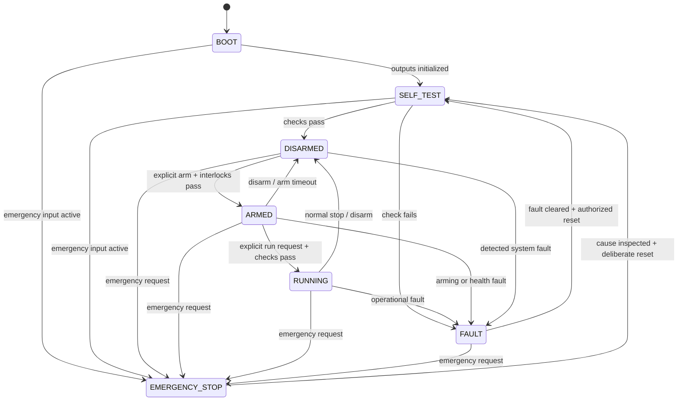

# RAIL-F01 — Safety State Machine Baseline

This is a behavioral baseline for future implementation. The state machine and safety manager run locally on the ESP32. Safety inhibition has authority over operator input, control output, and dashboard requests. A physical emergency power interruption is a separate hardware function and must not depend on the dashboard or ordinary application scheduling.

## States

| State | Purpose and high-level entry conditions | Expected motor / actuator behavior |
|---|---|---|
| `BOOT` | Reset or power-up begins. Initialize outputs to a non-energizing hardware-defined condition before enabling other functions. | No propulsion command; outputs held in hardware-safe state. Exact pin and ESC behavior TBD. |
| `SELF_TEST` | Enter after basic initialization. Check required sensor availability/freshness, configuration validity, switch plausibility, battery monitor plausibility, and controller input path. | Inhibited; motors must remain stopped/disarmed. No motor spin test in this baseline. |
| `DISARMED` | Self-test passes, operator disarms, or a recoverable stop completes. Default idle state. | Actuator outputs remain inhibited or command the verified disarmed value; exact ESC protocol semantics TBD. |
| `ARMED` | Explicit local arm action accepted while all arming interlocks pass; no active fault or emergency stop. | Propulsion remains at verified zero/minimum-safe command; no thrust until `RUNNING`. |
| `RUNNING` | Explicit start/enable action accepted while armed and all required interlocks remain healthy. | ESP32 may issue bounded actuator commands under local control and safety supervision. |
| `FAULT` | A fault requiring inhibition occurs. Latch fault information and prevent operation until cleared under defined recovery conditions. | Immediately inhibit propulsion using verified actuator-safe behavior. Exact ESC response and whether the ESC itself disarms are TBD. |
| `EMERGENCY_STOP` | Emergency stop input/action or condition requiring immediate latched stop occurs. Highest-priority stop state; requires deliberate reset after cause inspection. | Request immediate actuator inhibition and activate the independent hardware interruption path if designed/available. Do not assume software output alone removes battery power. |

## Allowed transitions

Any state may transition to `EMERGENCY_STOP` when the emergency condition is detected. A reset is accepted only after the emergency input is released, the cause has been inspected, and an explicit reset is made. Emergency stop is latched; it does not transition directly to `ARMED` or `RUNNING`.

## Limit-switch command authority

Limit-switch handling runs locally on the ESP32 and does not depend on the dashboard. An active upper travel limit overrides normal upward motion commands, and an active lower travel limit overrides normal downward motion commands. A limit switch prevents commanding motion farther into its active boundary. This authority is higher than normal operator commands, references, control outputs, and motor-mixer requests. Motion away from an active boundary may be permitted only when consistent with the current safety state and future implementation rules. The exact electrical implementation and final recovery behavior remain TBD.

## Fault and emergency conditions

Conditions that should force `FAULT` include, at minimum:

- Required IMU or ToF data missing, invalid, stale, or outside configured plausibility bounds while needed for operation.
- Upper/lower limit switch activation inconsistent with the commanded operating envelope, simultaneous activation where physically implausible, or detected switch wiring fault where diagnosable.
- Battery voltage outside the configured safe operating range, or battery monitor reading invalid/stale.
- Gamepad disconnect or stale command while operator input is required for the selected mode.
- Invalid configuration, control task timing overrun, watchdog/reset indication, or internal state inconsistency.
- Actuator interface error or command update timeout if detectable with the selected ESC/protocol.

Conditions that should force `EMERGENCY_STOP` include:

- Physical emergency stop activation.
- A high-severity safety event designated for immediate latched shutdown, such as uncontrolled motion, hard travel-boundary violation, or a fault that cannot be handled by ordinary disarm.
- Safety manager detection that control/actuator inhibition cannot be trusted to complete through the normal path.

Final thresholds, debounce, persistence, severity mapping, sensor freshness windows, and reset authority are TBD and must be justified during detailed design and risk analysis.

## Interlocks and recovery

- Arming requires successful self-test, valid configuration, no active/latching fault, emergency stop released, and plausible battery and limit-switch state.
- `RUNNING` requires a deliberate run request and continued health of all signals required by the selected control mode.
- Returning from `FAULT` requires the fault cause cleared, an explicit reset, and a new self-test. Recovery must not resume thrust automatically.
- Returning from `EMERGENCY_STOP` requires inspection and deliberate reset; if power was physically interrupted, a fresh boot/self-test is required.
- Dashboard commands cannot arm, clear a latched emergency, or override local safety interlocks in this baseline.
- ESC-safe output, ESC timeout behavior, and hardware power interruption must be validated with the selected hardware before any motor test.
