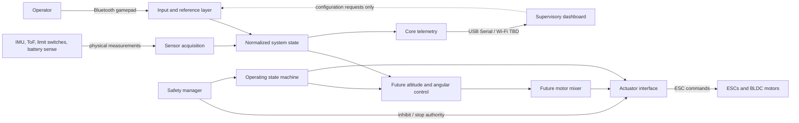

# RAIL-F01 — System Architecture Baseline

**Project:** RailDrone Control System

**Baseline status:** Provisional; hardware interfaces and component choices remain subject to verification.

## Purpose and scope

This document defines the first formal system architecture baseline for the rail-mounted aerial/mechatronic platform. The aerial unit is mechanically constrained by a rail and carriage. The expected primary controlled variables are vertical position/height, `z(t)`, and angular orientation, `theta(t)`.

This baseline documents responsibilities and interfaces only. It does not implement sensor drivers, control algorithms, a motor mixer, actuator commands, telemetry transport, or dashboard behavior. Exact ToF, motors, ESCs, propellers, battery, regulator/BEC, and ESC protocol are not selected.

## System context

The ESP32 DevKit is the real-time central controller. It owns physical input acquisition, normalized state, operator input processing, future real-time control, safety, operating state, actuator command generation, and core telemetry. An external dashboard is supervisory: it may display telemetry and provide configuration requests, but it is not in the stabilization or safety loop.



## Architectural layers and responsibilities

| Layer | Responsibility | Baseline boundary |
|---|---|---|
| Sensors | Acquire physical measurements | BNO085, ToF, upper/lower switches, battery monitor; exact parts and bus details remain provisional. |
| State representation | Present a normalized snapshot to other layers | Define units, validity, timestamp, and freshness consistently; exact software types are future work. |
| Input/reference | Convert gamepad/operator requests into references or manual commands | Local controller processing on ESP32. Dashboard configuration is supervisory and must not bypass safety. |
| Control | Future altitude and angular controllers | Executes on ESP32 with real-time timing; no algorithm is selected here. |
| Motor mixer | Future mapping from control effort to individual propulsion demands | Conceptual only; no mixer implementation or allocation policy in this baseline. |
| Actuator | Convert bounded demands into ESC commands | ESP32 owns command generation. Protocol, arming sequence, neutral values, and timeout behavior are TBD. |
| Safety manager | Independently inhibit or stop actuation | Has authority above control and operator input. Physical power interruption is a separate hardware safety measure to be engineered. |
| State machine | Govern operating state and permitted operation | Defined in [safety-state-machine.md](safety-state-machine.md); implementation is out of scope. |
| Telemetry | Publish system state and health | Generated by ESP32. Initial data contract is in [telemetry-baseline.md](../protocols/telemetry-baseline.md). |
| Dashboard | External monitoring and configuration | Supervisory only; never responsible for real-time stabilization or safety. |

## Control concept

The initial concept has two propulsion channels. Their combined thrust is expected to influence vertical force, while differential thrust is expected to influence angular motion. The conceptual allocation is:

```text
u1 = u_base + u_z + u_theta
u2 = u_base + u_z - u_theta
```

This is an architectural concept, not a defined control law. Sign conventions, units, saturation, actuator dynamics, and achievable authority require mechanical and hardware characterization before implementation.

## Computer responsibility and communications

The ESP32 remains responsible for sensor acquisition, real-time control, safety logic, state machine, actuator commands, gamepad processing, and core telemetry. USB Serial supports development and debugging. Bluetooth is the expected gamepad path. Wi-Fi is the provisional wireless dashboard telemetry path; protocol and remote configuration rules are TBD. Loss or delay of a dashboard connection must not interrupt local safety or stabilization responsibilities.

## Design constraints and open points

- The ESP32 DevKit and BNO085 are known/likely choices; exact board revision and BNO085 breakout are not frozen.
- I2C sharing between BNO085 and ToF is provisional. Address conflicts, bus voltage, pull-ups, cable length, and recovery behavior must be checked against selected modules.
- Motor/ESC command protocol and safe command behavior are TBD; software cannot assume that a particular numeric command stops a motor.
- Radio coexistence between Bluetooth gamepad and Wi-Fi telemetry must be validated on the selected ESP32 module and antenna/layout.
- Electrical isolation, grounds, power switching, and physical emergency interruption require detailed electrical and mechanical design before powered tests.
