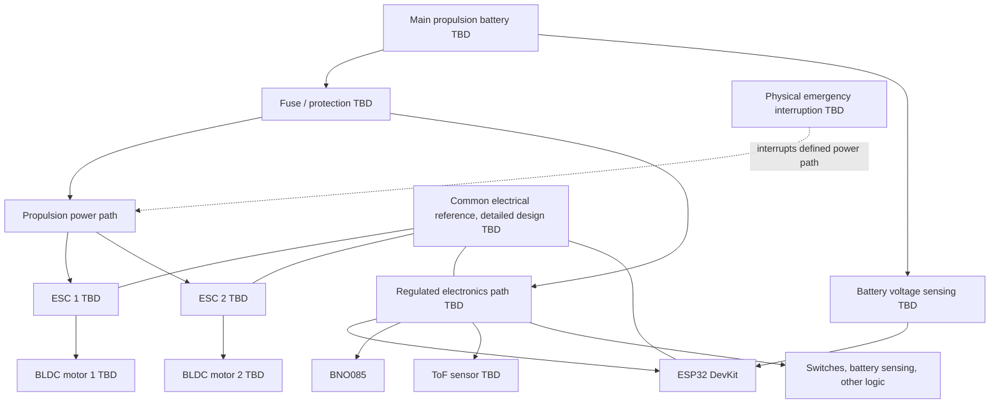

# RAIL-F01 — Conceptual Power Architecture

This is a first conceptual distribution baseline. Battery chemistry, cell count, voltage range, current capability, regulator/BEC, wiring, connector, fuse, and emergency disconnect are all TBD. No component values or ratings are selected here.

## Distribution concept

The diagram shows functional paths, not a final wiring schematic. The location and scope of the emergency interruption path are intentionally unresolved: the design must define whether it disconnects propulsion only, the full battery path, or another independently justified path.

## Design considerations

- **Common electrical reference:** Define signal-return references among ESP32, ESC command inputs, sensing circuits, and regulated supplies. Avoid uncontrolled ground loops and verify whether isolation is needed. A shared reference must be deliberate and compatible with the ESC interface.
- **Voltage regulation:** Derive the electronics supply from a regulator/BEC compatible with the selected battery and load. Confirm transient behavior, thermal capacity, input range, output rails, and any sensor-specific voltage needs. Do not power the ESP32 or sensors directly from an unregulated propulsion battery.
- **Current capability:** Size conductors, connectors, protection, regulator/BEC, and distribution for measured/credible peak and continuous loads after motors and ESCs are selected. Include startup and transient current.
- **Motor electrical noise:** Route motor phase and high-current battery wiring away from IMU, ToF, switch, and ADC wiring. Plan return paths and filtering to limit conducted/radiated interference and sensor resets or measurement corruption.
- **Decoupling:** Provide appropriate local bulk and high-frequency decoupling at the regulator outputs and sensitive loads according to the selected components and layout. Values and placement are TBD pending design and measurement.
- **Battery monitoring:** Use a protected, scaled measurement path compatible with the ESP32 ADC and full battery range. Calibrate it, account for ADC characteristics and filtering, and define invalid-reading and low-voltage thresholds after battery selection.
- **Fuse / protection:** Select protection appropriate to battery fault current, wiring, connectors, ESC branches, and regulator branch. Fuse coordination and placement are TBD; a fuse does not replace emergency stopping.
- **Emergency power interruption:** Provide an accessible physical means to interrupt hazardous propulsion power, designed for the actual current and DC interruption duty. Determine whether it latches and how restart is prevented. Software emergency stop is not a substitute for this hardware path.
- **Grounding and layout:** Separate high-current paths from logic/sensor returns and join them according to a reviewed power layout. Verify sensor operation and ADC stability under motor/ESC switching conditions before closed-loop operation.

## Open decisions

Battery chemistry/cell count, ESC and motor ratings, propulsion connector and wiring, regulator/BEC topology and rating, protection devices, physical emergency disconnect topology, grounding strategy, and voltage measurement circuit remain open until hardware is selected and loads are characterized.
